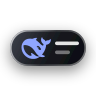
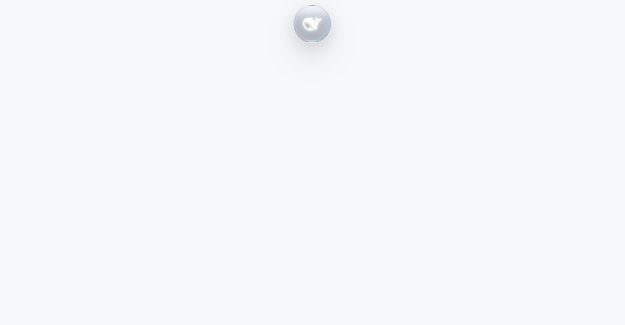
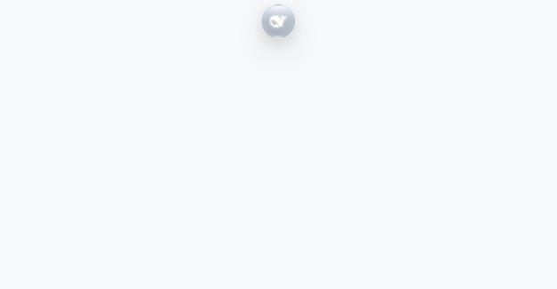
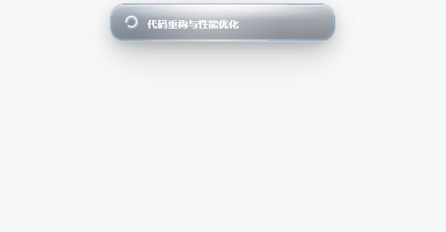
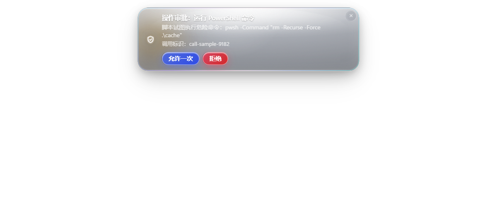
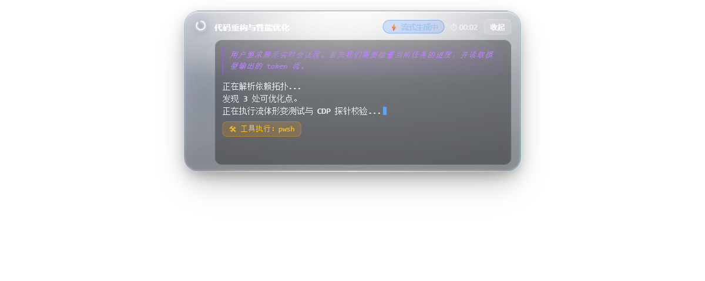

# 灵动岛 · dsh-island

<p align="center">
  
</p>

<p align="center">
  <strong>DeepSeek Harness 灵动岛：屏幕顶部中央的 Apple Liquid Glass 液态玻璃悬浮通知与实时交互组件。</strong>
</p>

<p align="center">
  <a href="./LICENSE"></a>
  <a href="./package.json"></a>
  <a href="./tests"></a>
  
</p>

---

## 一、丝滑动效展示

### 1. 液态形变与展开收缩（Fluid Morphing Lifecycle）
基于 Apple 原生 `cubic-bezier(.32, .72, 0, 1)` 弹簧阶跃响应驱动的液态形变：正圆 $\rightarrow$ 胶囊 $\rightarrow$ 圆角矩形展开，内容钉死不重排，收起时由外壳自然擦除裁切，干净落点零回弹：

<p align="center">
  
</p>

---

### 2. iPhone 原生触感：按压放大、触点光晕与流体果冻回弹（Haptics & Jiggle）
还原真实流体手感：按下瞬间 `scale(1.3)` 饱满微膨胀，触碰点原位绽放聚焦水光；拖动时沿极坐标光滑超椭圆流体张力拉伸，松手伴随果冻微颤（Damped Harmonic Oscillator）瞬时归位：

<p align="center">
  
</p>

---

### 3. 会话进行中：轻点展开实时会话流视窗（Live Activity Stream）
会话正在进行时，灵动岛能量环进入呼吸微脉冲；轻点岛体即刻展开宽幅视窗，实时呈现**深度思考链（Reasoning / CoT）、流式输出 Token、正在调度的工具与毫秒级计时**，一键丝滑折叠：

<p align="center">
  
</p>

---

## 二、消息类型与形态预览

灵动岛内置完善的消息类型注册表（`TYPE_REGISTRY`），针对不同情境呈现专属的光学倒角与交互布局：

| 消息类型 | 预览效果 | 场景说明与交互特征 |
|---|---|---|
| **任务完成**<br>`SUCCESS` |  | 翡翠极光次表面光晕，极简晶莹胶囊，展示会话标题与耗时，展示完毕后优雅收回 |
| **任务失败**<br>`ERROR` |  | 绯红烈焰自发光，精准抓取异常原因并呈现，同会话失败自动合并防刷屏 |
| **方案选择**<br>`ACTION_REQUIRED` |  | 量子湛蓝微光，浮动晶体胶囊选项（Primary/Default 样式），支持直接在岛上单选作答并送回 Harness |
| **操作审批**<br>`CONFIRM` |  | 盾牌安全确认卡片，展示高危命令与调用标识，支持一键「允许一次」或「拒绝」，顶栏与留白防溢出 |
| **实时会话流**<br>`LIVE_STREAM` |  | 会话进行中专属形态，顶部固定 Header 防挤压，支持思考块独立展示、代码流自动滚底与复制 |
| **按压触点高光**<br>`TOUCH_DOWN` |  | 按下触碰点原位绽放 80px 聚焦纯净高光，等比弹性放大 `scale(1.3)`，无杂乱色块散射 |

---

## 三、4 套次世代液态玻璃材质预设

内置 4 款次世代光学液态玻璃配方，可在设置中任意切换或跟随系统自动调度：

<p align="center">
  
  
  
  
</p>

1. **深空曜石（Midnight Liquid Crystal）**：经典午夜高透流体晶体，双段光锥聚焦透光 + 0.75px 彩虹色散倒角（青-紫-洋红-金），深邃静谧；
2. **超白水晶（Pure Crystal）**：超白微晶透镜，超高白度折射玻璃 + 冰蓝紫微衍射边缘 + 柔和室内漫射投影；
3. **极光幻彩（Nebula Aurora）**：星云极光次表面，高饱和洋红与青翠极光光锥交融 + 晶粉微光环 + 双曲面月牙粉紫高光；
4. **微晶雾面（Frosted Obsidian）**：漫反射微晶基底 + 0.065 重度星光微晶噪点 + 低反差香槟银折射倒角，温润雅致。

---

## 四、系统架构与关键工程突破

```
                       ┌──────────────────── Host 进程（Node） ────────────────────┐
  Harness 事件  ──▶  src/watcher.js   （事件层：状态流/会话流实时捕获 → Notification）
                       │
  user-questions ──▶  src/questions.js（交互层：提问瀑布 prepend + 岛上等待 + 答案回传）
  approval/req   ──▶  src/approval.js （审批层：工具权限瀑布 prepend + 允许/拒绝决议）
                       │
                       ├──▶ src/notification.js （消息层：模型 + 可扩展类型注册表）
                       ├──▶ src/store.js        （状态层：盖章/环形历史/待处理集合/订阅/唤醒）
                       ├──▶ src/config.js       （配置层：三层合并 + 实时预览广播 + 自动落盘）
                       ├──▶ src/desktop.js      （窗口层：启动器供给 + 进程生命周期 + 启停开关）
                       └──▶ src/routes.js       （传输层：/api/dsh-island/*，含 UI 与流端点）
                       └──────────────────────────────────────────────────────────┘
                                     │  HTTP（长轮询 + 实时流端点）
                                     ▼
                       独立 Electron 桌面悬浮窗（desktop/main.js 创建窗口）
                                     │
                        ui/window.html 加载 ui/island.js
```

### 关键技术保障与踩坑解决机制
1. **独立 Electron 运行时复用**：Host 运行于 Node 环境，不具备窗口能力。插件就地提取 Harness 自带的 Electron 运行时，另起独立进程管理常驻悬浮窗，不占额外磁盘空间；
2. **窗口常显与穿透锁（防死锁）**：为防止 Chromium 将隐藏窗口当成后台标签页挂起节流，悬浮窗在物理上**始终常显（完全透明）**，依靠 `setIgnoreMouseEvents` 实现像素级点击穿透；当鼠标处于按压拖拽时锁定接管，**100% 杜绝松手事件被操作系统偷走导致卡死**；
3. **极坐标连续超椭圆阻尼**：消除传统方形盒子的直角死角，全 360° 弧形位移严格控制在水平 $\pm 9\text{px}$、垂直 $+10\text{px}$ 内，各向同性连续拉伸；
4. **实时会话流防顶飞约束**：流视窗顶部 Header 采用硬性 Flex 锚定，超长思考链与代码块在独立内部视窗内平滑滚动，顶栏 UI 控件绝对不被顶飞；
5. **纯数学程序化触感微音效**：基于 Web Audio API 纯数学振荡器实时演算，零外部音频资源依赖。

---

## 五、形态与参数配置

在 **设置 → 灵动岛** 调整任何滑杆或开关，灵动岛均会在 **50ms 内即时热响应**，无需保存即可对照微调：

| 配置项 | 默认值 | 范围 | 说明 |
|---|---|---|---|
| `desktopWindow` | `true` | 开 / 关 | **桌面悬浮窗总开关**：关掉后彻底关闭 Electron 悬浮窗进程 |
| `enabled` | `true` | 开 / 关 | **功能总开关**：关闭后不再监听任务事件与产生通知 |
| `persistent` | `true` | 开 / 关 | **常驻屏幕**：开启时闲置状态保持最小正圆，关闭时完全滑出屏幕 |
| `minSize` | **`30`** | 26 – 56 px | **最小圆直径**：Logo 与内部光环等比自动归心缩放 |
| `maxWidth` | **`460`** | 280 – 900 px | **展开最大宽度**：卡片与实时流面板的横向最大尺寸 |
| `textScale` | **`1.0`** | 0.8 – 1.35 | **文字大小倍率**：标题、正文、选项文字等比缩放，卡片尺寸自适应重测 |
| `durationScale` | **`1.2`** | 0.4 – 3.0 | **动画时长倍率**：形变、位移与收缩节奏舒缓度 |
| `bounce` | **`0.62`** | 0 – 1.0 | **弹性强度**：默认保持 Apple 干净落点，推满产生鲜明果冻感 |
| `materialTheme` | **`auto`** | 下拉预设 | **材质预设**：`auto` (跟随系统) / `midnight` (深空曜石) / `pure-crystal` (超白水晶) / `aurora` (极光幻彩) / `frosted` (微晶雾面) |
| `sound` | **`true`** | 开 / 关 | **触感音效**：弹出、展开、收起时由 Web Audio 纯数学合成微滴轻触音 |
| `soundVolume` | **`0.6`** | 0 – 100% | **音效音量** |
| `interceptQuestions` | **`true`** | 开 / 关 | **方案选择接管**：在灵动岛上直接点击选项答复任务 |
| `interceptApprovals` | **`true`** | 开 / 关 | **操作审批接管**：高危工具调用直接在岛上一键「允许一次」或「拒绝」 |
| `notifyOnTaskStart` | `false` | 开 / 关 | **任务开始提示**：每轮任务启动时是否展示「任务执行中」 |

---

## 六、安装与使用

### 方式 A：通过 DeepSeek Harness 插件管理器（推荐）
在 Harness 会话中调用 `plugin_manager` 安装即可：
```javascript
// 安装 bundle
await plugin_manager({ action: 'install_bundle', target: 'dsh-island' })
```

### 方式 B：手动挂载开发
1. 将本仓库 clone 到本地；
2. 确保 `package.json` 中的 `dsh.bundle.patch` 正确挂载 `cordis.patch.yml`；
3. 重启一次 DeepSeek Harness，插件将自动供给运行时并启动灵动岛置顶悬浮窗。

---

## 七、验证与测试体系

本项目包含 **185 项离线自动化测试** 以及基于真实 Electron 运行时的 **CDP 逐帧渲染探针**：

```powershell
# 运行全部离线单元测试（185 项全部通过）
npm test

# 分别运行核心与 Host 自检
node tests/selftest.mjs        # 92 项：运动曲线 profile、极坐标连续形变、材质光谱、CONFIRM 审批动作、倒计时重激活等
node tests/host-selftest.mjs   # 93 项：实时流事件捕获、操作审批瀑布桥接、状态仓库合并、会话生命周期释放等
```

### CDP 真机探针说明（位于 `_selftest/`）
- `island-layout-probe.mjs`：形变过程中文字不重排（scrollWidth 恒定）、上下不滑动；
- `island-enter-probe.mjs`：弹出全程高宽比 = 1.000 正圆、停顿符合配置；
- `island-answer-probe.mjs`：作答后走 COLLAPSING 收缩动画，文字被外壳自然裁切而非闪烁消失。

---

## 八、开源许可证

本项目采用 [MIT License](./LICENSE) 授权许可。  
Copyright (c) 2026 inju0524 (Yin Shaokai).
